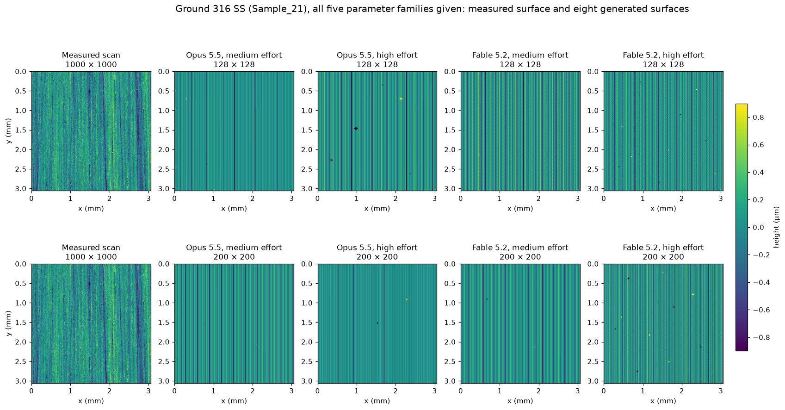
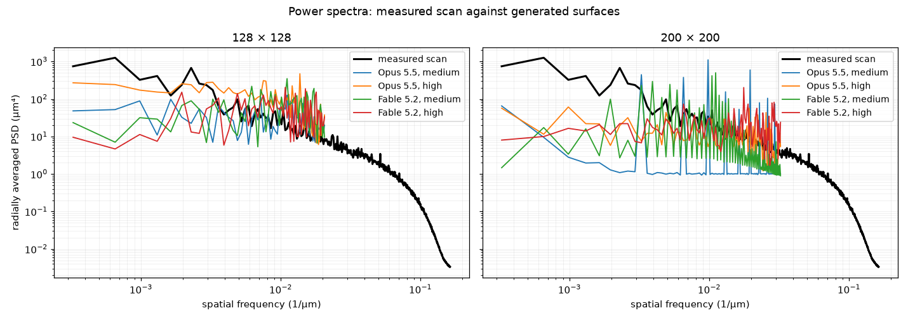

# Pilot results, 2026-11-12

Eight single generations on one surface, to check that the pipeline works, measure token use, and
set a budget. These are not benchmark results: each cell is one run, so differences between models
or effort levels may be run-to-run variation.

## Setup

| Item | Value |
| --- | --- |
| Surface | Sample_21: ground 316 SS, 1000 × 1000 points at 3.06 µm, 3.06 mm field, best-fit plane removed |
| Targets | 28 ISO 25178-2 parameters computed on the whole scan, no S- or L-filter |
| Level | 5: all five families given (height, spatial, hybrid, functional/volume, feature) |
| Output | 128 × 128 or 200 × 200 integers spanning the whole field, one labelled row per line (`R001:` …) |
| Models | Claude Opus 5.5 and Claude Fable 5.2, medium and high effort |
| Client | Claude Code CLI in print mode on a claude.ai subscription; no tools, benchmark prompts only |

The exact prompt for each run is in its run folder as `prompt.txt`.

## Output validity

| Output contract | Runs | Valid |
| --- | --- | --- |
| Rows without labels | 2 (Opus 5.5 medium, 128 and 200) | 0: both stopped six rows short (122 of 128, 194 of 200) |
| Rows labelled `R001:` … | 8 | 8 |

## Tokens and cost

Costs use the batch price, which is half the standard price (Opus 5.5 $2 / $10 and Fable 5.2
$4 / $20 per million input / output tokens in batch). Standard pricing is double. The full design
is 13 surfaces × 5 levels × K repeats.

| Grid | Model | Effort | Output tokens | of which thinking | Time | Batch cost per run | K = 3 (195 runs) | K = 5 (325 runs) |
| --- | --- | --- | --- | --- | --- | --- | --- | --- |
| 128 | Opus 5.5 | medium | 34,334 | 1,167 | 3.7 min | $0.35 | $68 | $113 |
| 128 | Opus 5.5 | high | 35,456 | 2,289 | 3.9 min | $0.36 | $70 | $116 |
| 128 | Fable 5.2 | medium | 35,720 | 2,425 | 4.1 min | $0.72 | $141 | $234 |
| 128 | Fable 5.2 | high | 36,330 | 3,035 | 5.2 min | $0.73 | $143 | $238 |
| 200 | Opus 5.5 | medium | 81,684 | 1,069 | 8.6 min | $0.82 | $160 | $267 |
| 200 | Opus 5.5 | high | 82,785 | 2,170 | 8.9 min | $0.83 | $162 | $270 |
| 200 | Fable 5.2 | medium | 81,838 | 1,023 | 9.1 min | $1.64 | $320 | $534 |
| 200 | Fable 5.2 | high | 87,674 | 6,859 | 10.7 min | $1.76 | $343 | $572 |

Input is about 1,680 tokens per run and contributes under 1% of the cost.

- Cost is set by the grid: about 2 tokens per height value, so 200 × 200 costs 2.3–2.4× as much as 128 × 128.
- Thinking is 1–8% of output. High effort adds 1–7% to the cost.
- Fable 5.2 costs twice Opus 5.5 for the same output.
- Level 5 has the longest prompt, so these are upper bounds per run; lower levels cost almost the same because output dominates.

## Generated surfaces

Every run produced the same kind of surface: straight vertical stripes with a few deep straight
grooves and a handful of isolated one-pixel spikes and pits. The lay direction is right. The
measured surface has irregular, interrupted grinding marks and broad variation across the field,
which none of the generated surfaces has.

The generated spectra are rows of sharp peaks (periodic stripes) and sit well below the measured
spectrum at long wavelengths. The generated curves end where the output grid's resolution ends.

## Scores by family

Each cell is the median relative error in that family, with the number of parameters within 10% in
brackets. The last row scores the measured surface itself, resampled to the output grid, against
the same whole-scan targets.

| Grid | Surface | Height (7) | Spatial (3) | Hybrid (2) | Functional (9) | Feature (7) | Within 10%, of 28 | PSD difference |
| --- | --- | --- | --- | --- | --- | --- | --- | --- |
| 128 | Opus 5.5, medium | 0.24 (3) | 0.03 (2) | 0.92 (0) | 0.42 (2) | 37.5 (0) | 7 | 0.60 |
| 128 | Opus 5.5, high | 0.00 (4) | 0.27 (1) | 0.87 (0) | 0.09 (5) | 16.1 (0) | 10 | 0.59 |
| 128 | Fable 5.2, medium | 0.13 (3) | 0.06 (2) | 0.88 (0) | 0.13 (1) | 10.9 (0) | 6 | 0.79 |
| 128 | Fable 5.2, high | 0.22 (3) | 0.07 (2) | 0.90 (0) | 0.20 (3) | 9.3 (0) | 8 | 0.75 |
| 128 | Measured surface, resampled | 0.55 (0) | 0.85 (1) | 0.95 (0) | 0.41 (2) | 0.80 (1) | 4 | 0.31 |
| 200 | Opus 5.5, medium | 0.02 (5) | 0.19 (1) | 0.82 (0) | 0.37 (1) | 7.1 (0) | 7 | 1.26 |
| 200 | Opus 5.5, high | 0.34 (3) | 0.34 (1) | 0.89 (0) | 0.39 (1) | 50.3 (0) | 5 | 0.58 |
| 200 | Fable 5.2, medium | 0.15 (3) | 0.30 (1) | 0.86 (0) | 0.17 (1) | 16.1 (0) | 5 | 0.89 |
| 200 | Fable 5.2, high | 0.08 (5) | 0.44 (1) | 0.84 (0) | 0.16 (2) | 8.6 (0) | 8 | 0.68 |
| 200 | Measured surface, resampled | 0.30 (0) | 0.57 (1) | 0.91 (0) | 0.29 (2) | 0.77 (0) | 3 | 0.24 |

PSD difference is the RMS gap between the generated and measured spectra in powers of ten, over the
band both resolve; 0.6 is about a factor of 4.

## What the pilot shows

1. **The row label fixes the format.** Without it both outputs were short; with it all eight were valid.
2. **Extremes are matched, texture is not.** Sp, Sv and Sz are within 2% in seven of eight runs
   (Fable high at 128 chose a shallower scale and missed Sv by 28%). The models get there by adding
   a few isolated spikes and grooves to an otherwise regular pattern.
3. **Distribution shape is the hard part of the height family.** Kurtosis is off by 26% to 12× and
   skewness by 5% to 6×. Fable at high effort was closest (kurtosis within 26–29% at both sizes).
4. **Slopes are limited by the grid, not the model.** Sdq and Sdr are 72–98% low in every run, and
   the measured surface resampled to the same grid is 84–99% low.
5. **The feature family fails by orders of magnitude.** Hill and dale areas are 7–67× too large and
   volumes 26–300× too large, because the generated surfaces have a few large motifs. Peak density
   and curvature are 88–98% low, about the same as the resampled measured surface.
6. **Generated surfaces are too anisotropic.** Str is 54–82% low in every run: perfect stripes
   correlate along their whole length, real grinding marks do not.
7. **The measured surface itself scores 3–4 of 28 on these grids.** With targets taken at full
   resolution, a faithful lower-resolution copy of the real surface misses Sa and Sq by 30–41%,
   because resampling removes fine roughness. A generated surface that matches Sa on the coarse
   grid is therefore rougher at that scale than the real one. Low error against these targets and
   resemblance to the real surface are different things, and the PSD column shows it: the resampled
   measured surface has the best PSD score and nearly the worst parameter score.
8. **No clear effect of model or effort.** Parameters within 10% range from 5 to 10 of 28 with no
   consistent ordering. One run per cell cannot separate these.

## Per-parameter relative error

Std is an angular error scaled so that 90° off is 1. Column headers are grid, model, effort.

| Param | Target | 128 Opus med | 128 Opus high | 128 Fable med | 128 Fable high | 200 Opus med | 200 Opus high | 200 Fable med | 200 Fable high |
| --- | --- | --- | --- | --- | --- | --- | --- | --- | --- |
| Sa | 0.208 µm | 0.35 | 0.00 | 0.15 | 0.01 | 0.03 | 0.40 | 0.16 | 0.08 |
| Sq | 0.2787 µm | 0.24 | 0.20 | 0.13 | 0.01 | 0.01 | 0.34 | 0.15 | 0.02 |
| Ssk | -2.12 | 5.82 | 3.23 | 0.98 | 0.41 | 0.68 | 3.85 | 1.25 | 0.05 |
| Sku | 56.66 | 12.64 | 3.39 | 1.70 | 0.29 | 0.85 | 9.47 | 2.65 | 0.26 |
| Sp | 3.503 µm | 0.00 | 0.00 | 0.01 | 0.00 | 0.02 | 0.00 | 0.00 | 0.00 |
| Sv | 12.53 µm | 0.00 | 0.00 | 0.00 | 0.28 | 0.00 | 0.00 | 0.00 | 0.10 |
| Sz | 16.04 µm | 0.00 | 0.00 | 0.00 | 0.22 | 0.00 | 0.00 | 0.00 | 0.08 |
| Sal | 15.85 µm | 0.03 | 0.27 | 0.06 | 0.07 | 0.19 | 0.34 | 0.30 | 0.44 |
| Str | 0.02035 | 0.64 | 0.54 | 0.69 | 0.69 | 0.74 | 0.78 | 0.57 | 0.82 |
| Std | 89° | 0.01 | 0.01 | 0.01 | 0.01 | 0.01 | 0.01 | 0.01 | 0.01 |
| Sdq | 0.05429 | 0.86 | 0.78 | 0.80 | 0.83 | 0.72 | 0.82 | 0.77 | 0.74 |
| Sdr | 0.1459 % | 0.98 | 0.95 | 0.96 | 0.97 | 0.92 | 0.97 | 0.94 | 0.93 |
| Sk | 0.6342 µm | 0.42 | 0.09 | 0.14 | 0.09 | 0.30 | 0.38 | 0.17 | 0.16 |
| Spk | 0.2336 µm | 0.80 | 0.52 | 0.46 | 0.57 | 0.72 | 0.73 | 0.47 | 0.34 |
| Svk | 0.3741 µm | 0.09 | 0.70 | 0.12 | 0.23 | 0.61 | 0.42 | 0.14 | 0.20 |
| Smr1 | 8.724 % | 0.46 | 0.01 | 0.13 | 0.49 | 0.37 | 0.37 | 0.26 | 0.38 |
| Smr2 | 87.55 % | 0.04 | 0.00 | 0.02 | 0.05 | 0.09 | 0.00 | 0.02 | 0.01 |
| Vmp | 0.01188 µm³/µm² | 0.74 | 0.46 | 0.31 | 0.52 | 0.68 | 0.72 | 0.54 | 0.24 |
| Vmc | 0.2301 µm³/µm² | 0.35 | 0.09 | 0.23 | 0.02 | 0.14 | 0.37 | 0.10 | 0.16 |
| Vvc | 0.2905 µm³/µm² | 0.43 | 0.09 | 0.13 | 0.14 | 0.29 | 0.39 | 0.18 | 0.06 |
| Vvv | 0.03855 µm³/µm² | 0.18 | 0.40 | 0.10 | 0.20 | 0.61 | 0.43 | 0.16 | 0.16 |
| Spd | 16.5 /mm² | 0.97 | 0.94 | 0.92 | 0.90 | 0.88 | 0.98 | 0.94 | 0.90 |
| Spc | 72.44 /mm | 0.96 | 0.98 | 0.97 | 0.96 | 0.96 | 0.92 | 0.95 | 0.92 |
| S10z | 8.893 µm | 0.32 | 0.34 | 0.52 | 0.31 | 0.54 | 0.32 | 0.54 | 0.15 |
| Sda | 4.576e4 µm² | 50.0 | 17.6 | 16.0 | 11.8 | 9.20 | 67.0 | 21.7 | 9.74 |
| Sha | 6.062e4 µm² | 37.5 | 16.1 | 10.9 | 9.27 | 7.11 | 50.3 | 16.1 | 8.62 |
| Sdv | 1574 µm³ | 112 | 86.6 | 57.2 | 35.6 | 60.0 | 87.2 | 178 | 31.0 |
| Shv | 2053 µm³ | 243 | 77.8 | 53.6 | 25.9 | 43.7 | 301 | 173 | 26.7 |

## Individual comparison figures

Each shows the measured scan, the generated surface, and both spectra.

| Grid | Opus 5.5 medium | Opus 5.5 high | Fable 5.2 medium | Fable 5.2 high |
| --- | --- | --- | --- | --- |
| 128 | [figure](figures/g128_opus_medium.png) | [figure](figures/g128_opus_high.png) | [figure](figures/g128_fable_medium.png) | [figure](figures/g128_fable_high.png) |
| 200 | [figure](figures/g200_opus_medium.png) | [figure](figures/g200_opus_high.png) | [figure](figures/g200_fable_medium.png) | [figure](figures/g200_fable_high.png) |

## Limits of this pilot

- One surface, one level, one generation per cell.
- The parameter code is not validated against ISO 25178-71 softgauges or commercial software. The
  feature family uses a simplified segmentation and is provisional.
- Runs went through a subscription client, not the API. Token counts carry over; reported results
  need API runs with pinned model strings.
- The two unlabelled runs used an earlier prompt (128 × 128 targets from a downsampled scan, and a
  3-pixel S-filter) and are counted only in the validity table.
