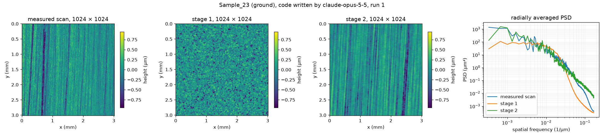
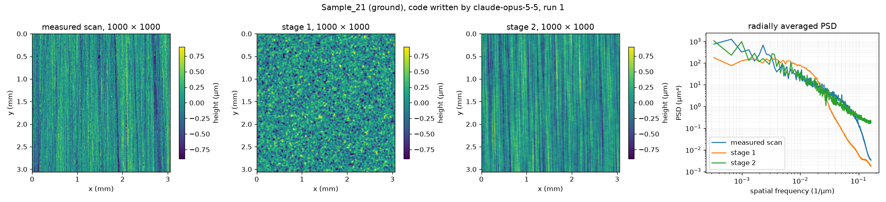
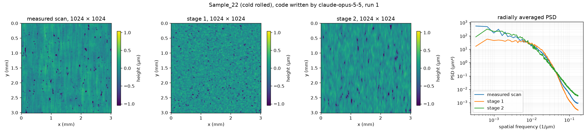
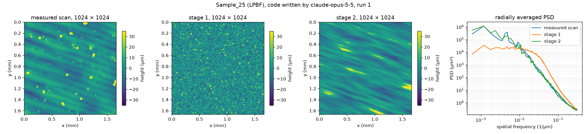
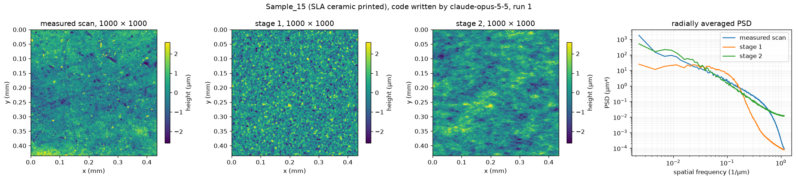
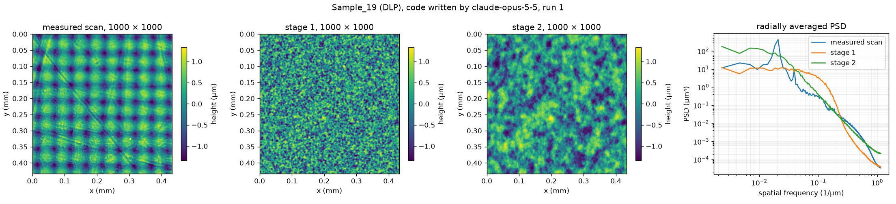
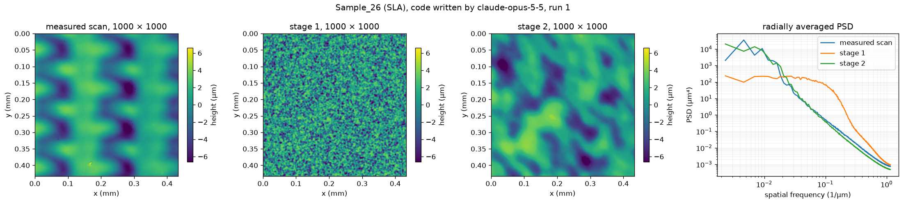

# Code-generation baseline: Claude Opus 5.5, 2026-11-24

First run of the code-generation design. The model writes one program; every surface is run
through it unchanged. This is a pilot on a claude.ai subscription, with one program from one model.

## Design

| Item | Value |
| --- | --- |
| Task | Write a program that generates a height map from ISO 25178-2 parameters and the grid |
| Stages | Stage 1 from height and functional/volume parameters; stage 2 built on stage 1 using all parameters |
| Prompt | Parameter definitions plus one example surface's values (Sample_23). No direction on method. See `prompt.txt` |
| Code | Written once, in a fresh session with no memory. Up to 5 test runs on the example, returning only the program's own printed output and whether its files were well formed |
| Output | Each scan's own size and sampling interval (1000 × 1000 or 1024 × 1024) |
| Execution | Sandboxed: no network, no home directory, read-only system, 10-minute limit per surface |
| Scoring | Least-squares plane removed, no S- or L-filter, 28 parameters compared with the whole-scan targets |
| Runs | 3 per surface |

## The session

| | |
| --- | --- |
| Model | `claude-opus-5-5`, medium effort |
| Turns | 2: one test run, then the final program |
| Tokens | 16,811 input, 16,191 output (7,239 thinking) |
| Cost | $0.39 at standard API prices; about $0.19 batch |
| Program | 190 lines (`program.py`), 47–83 s per surface |
| Valid outputs | 42 of 42 |

The model's replies and the test feedback it received are in `reply_1.md`, `feedback_1.txt` and `reply_2.md`.

## What the program does

The prompt gave no method. The model chose this:

1. **Height distribution.** Fits a quantile function to the 16 height and functional/volume values by
   numerical optimisation, then pins the extremes to Sp and Sv.
2. **Stage 1.** Generates isotropic correlated Gaussian noise (correlation length 8 sampling
   intervals) and assigns the fitted heights by rank.
3. **Stage 2.** Reuses the same noise and the same set of heights. Shapes the noise with an
   anisotropic autocorrelation model rotated to Std, measures its own Sal, Str and Sdq, and adjusts
   three settings in a loop until they match.

Points to note:

- Stage 1 reads only the stage 1 parameters (checked in the code).
- The feature parameters (Spd, Spc, S10z, Sda, Sha, Sdv, Shv) are never used.
- The random seed is fixed, so the three runs per surface are identical. A follow-up prompt asks for
  a different surface each run.
- The method is autocorrelation shaping followed by a height-distribution transform, the classical
  approach to surface synthesis.

## Scores

Median relative error per family, with the number of parameters within 10% in brackets. Sample_23
is the example the model saw.

| Surface | Stage | Height (7) | Functional (9) | Spatial (3) | Hybrid (2) | Feature (7) | Total of 28 | PSD difference |
| --- | --- | --- | --- | --- | --- | --- | --- | --- |
| Sample_23, ground (example) | 1 | 0.00 (7) | 0.00 (9) | 0.90 (1) | 0.24 (0) | 0.79 (1) | 18 | 0.78 |
| | 2 | 0.00 (7) | 0.01 (9) | 0.01 (3) | 0.01 (2) | 0.49 (1) | 22 | 0.67 |
| Sample_21, ground | 1 | 0.00 (7) | 0.00 (9) | 0.90 (0) | 0.66 (0) | 0.71 (1) | 17 | 1.05 |
| | 2 | 0.01 (7) | 0.01 (9) | 0.01 (3) | 0.01 (2) | 0.45 (1) | 22 | 0.78 |
| Sample_22, cold rolled | 1 | 0.00 (7) | 0.00 (9) | 0.59 (0) | 0.09 (1) | 0.54 (2) | 19 | 0.38 |
| | 2 | 0.00 (7) | 0.00 (9) | 0.00 (3) | 0.00 (2) | 0.17 (3) | 24 | 0.39 |
| Sample_25, LPBF | 1 | 0.00 (7) | 0.01 (7) | 0.68 (0) | 3.58 (0) | 0.94 (0) | 14 | 0.54 |
| | 2 | 0.01 (7) | 0.03 (7) | 0.01 (3) | 0.17 (1) | 0.63 (0) | 18 | 0.12 |
| Sample_15, SLA alumina | 1 | 0.00 (7) | 0.00 (9) | 0.81 (0) | 0.56 (0) | 1.33 (0) | 16 | 1.28 |
| | 2 | 0.01 (6) | 0.01 (9) | 0.03 (3) | 0.02 (2) | 0.69 (2) | 22 | 0.87 |
| Sample_19, DLP | 1 | 0.00 (7) | 0.00 (9) | 0.20 (1) | 1.04 (0) | 0.21 (2) | 19 | 0.62 |
| | 2 | 0.01 (7) | 0.01 (9) | 0.01 (2) | 0.01 (2) | 0.53 (1) | 21 | 0.43 |
| Sample_26, SLA polymer | 1 | 0.01 (7) | 0.04 (8) | 0.26 (0) | 26.9 (0) | 0.99 (0) | 15 | 0.90 |
| | 2 | 0.06 (6) | 0.05 (6) | 0.05 (3) | 0.02 (2) | 0.35 (2) | 19 | 0.21 |

The text-grid runs in `../README.md` reached 5–10 of 28 on Sample_21 and at most 12 of 28 on any sample.

## Slopes: Sdq and Sdr

These were unreachable on the 200 × 200 text grids (72–98% low in every run).

| Surface | Sdq target | Stage 1 | Stage 2 | Stage 2 error |
| --- | --- | --- | --- | --- |
| Sample_23 | 0.0230 | 0.0192 | 0.0231 | 0.4% |
| Sample_21 | 0.0543 | 0.0256 | 0.0542 | 0.1% |
| Sample_22 | 0.0178 | 0.0188 | 0.0178 | 0.1% |
| Sample_25 | 0.479 | 1.219 | 0.480 | 0.3% |
| Sample_15 | 0.800 | 0.432 | 0.799 | 0.2% |
| Sample_19 | 0.197 | 0.314 | 0.198 | 0.4% |
| Sample_26 | 0.169 | 1.452 | 0.168 | 0.6% |

| Surface | Sdr target (%) | Stage 1 | Stage 2 | Stage 2 error |
| --- | --- | --- | --- | --- |
| Sample_23 | 0.0264 | 0.0183 | 0.0266 | 0.8% |
| Sample_21 | 0.146 | 0.0315 | 0.143 | 1.8% |
| Sample_22 | 0.0158 | 0.0176 | 0.0158 | 0.1% |
| Sample_25 | 5.80 | 38.4 | 7.76 | 34% |
| Sample_15 | 23.9 | 8.34 | 24.9 | 4.2% |
| Sample_19 | 1.87 | 4.67 | 1.92 | 2.4% |
| Sample_26 | 1.34 | 63.0 | 1.39 | 3.8% |

Stage 2 tunes Sdq directly and reaches it within 1% on every surface. Sdr is not tuned; it follows
Sdq closely except on Sample_25, where the slope distribution is far from Gaussian (isolated steep
spatter) and matching the RMS slope does not fix the developed area. Stage 1 slopes are arbitrary,
since its correlation length is a fixed number of sampling intervals.

## Parameters still missed at stage 2

Relative error by surface; only parameters with at least one miss above 10% are listed.

| Parameter | 23 | 21 | 22 | 25 | 15 | 19 | 26 | Surfaces within 10% |
| --- | --- | --- | --- | --- | --- | --- | --- | --- |
| Ssk | 0.03 | 0.07 | 0.00 | 0.06 | 0.15 | 0.01 | 0.09 | 6 |
| Sp | 0.02 | 0.01 | 0.02 | 0.01 | 0.00 | 0.01 | 0.13 | 6 |
| Std | 0.00 | 0.00 | 0.00 | 0.01 | 0.03 | 0.17 | 0.09 | 6 |
| Sdr | 0.01 | 0.02 | 0.00 | 0.34 | 0.04 | 0.02 | 0.04 | 6 |
| Spk | 0.00 | 0.02 | 0.01 | 0.52 | 0.00 | 0.04 | 1.22 | 5 |
| Smr1 | 0.01 | 0.01 | 0.01 | 0.32 | 0.01 | 0.07 | 0.69 | 5 |
| Vmp | 0.02 | 0.00 | 0.00 | 0.04 | 0.00 | 0.02 | 0.70 | 6 |
| Spd | 0.18 | 0.10 | 0.05 | 0.51 | 1.04 | 0.53 | 0.35 | 1 |
| Spc | 0.57 | 1.55 | 0.65 | 6.77 | 2.42 | 0.35 | 1.93 | 0 |
| S10z | 0.07 | 0.45 | 0.04 | 0.23 | 0.02 | 0.01 | 0.03 | 5 |
| Sda | 0.49 | 0.45 | 0.69 | 0.65 | 0.00 | 0.38 | 0.08 | 2 |
| Sha | 0.15 | 0.09 | 0.05 | 1.05 | 0.51 | 1.11 | 0.26 | 2 |
| Sdv | 0.79 | 0.81 | 0.22 | 0.63 | 0.69 | 0.56 | 2.42 | 0 |
| Shv | 0.54 | 0.73 | 0.17 | 0.47 | 0.85 | 2.71 | 0.44 | 0 |

The misses are concentrated in the feature family, which the program does not use.

## Figures

Each shows the measured scan, stage 1, stage 2, and the radially averaged PSD of all three.

**Sample_23, ground 316 SS (the example)**

**Sample_21, ground 316 SS**

**Sample_22, cold rolled 316 SS with pits**

**Sample_25, LPBF Inconel 625**

**Sample_15, SLA alumina**

**Sample_19, DLP polymer**

**Sample_26, SLA polymer**

## What it shows

1. **Code generation removes the limits of the text grid.** Full-resolution output, slopes within 1%,
   and no format failures.
2. **The staging behaves as intended.** Stage 1 is isotropic texture that matches height and
   functional; stage 2 adds lay and matches spatial and hybrid while keeping the rest.
3. **Matching most parameters does not reproduce the surface.**
   - Sample_25: diagonal tracks and the PSD are reproduced (difference 0.12) with 18 of 28
     parameters matched, but the measured surface's round spatter particles are absent; the high
     points are smeared into streaks.
   - Sample_19: the measured surface is a regular square pixel grid with scratches; the generated
     one is unstructured blobs, and still matches 21 of 28 parameters.
   - Sample_23, Sample_21, Sample_15: random or grooved textures, visually close at stage 2.
4. **The feature family is the remaining gap in the numbers**, and discrete or periodic structure is
   the remaining gap in appearance.

## Limits

- One program from one model, written under one prompt.
- Runs are identical because the program fixes its seed; there is no spread to report.
- Sample_23's values were shown to the model. The other six surfaces were not.
- The parameter code is not validated against softgauges or commercial software. The model's
  program reimplemented several calculations from the prompt's one-line definitions, so agreement
  between its values and ours on those does not validate either.
- Sample_26 is identical to Sample_13 in the supplied data.
- Subscription client, not the API.

## Files

| File | Contents |
| --- | --- |
| `prompt.txt` | System and user prompt as sent |
| `program.py` | The model's final program |
| `reply_1.md`, `feedback_1.txt`, `reply_2.md` | The conversation |
| `parameters.csv` | Target, generated value and relative error for every surface, run, stage and parameter |
| `figures/` | One comparison figure per surface |

The height maps (`stage1.csv`, `stage2.csv`, `measured.csv`) and PSD tables are in the run folder
under `runs/`, which is not in git (454 MB).
